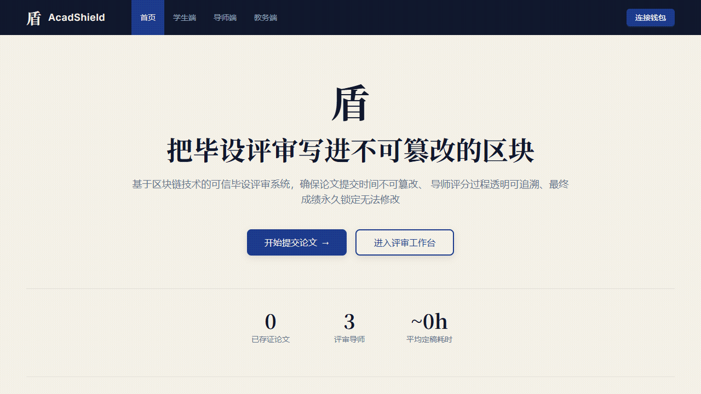
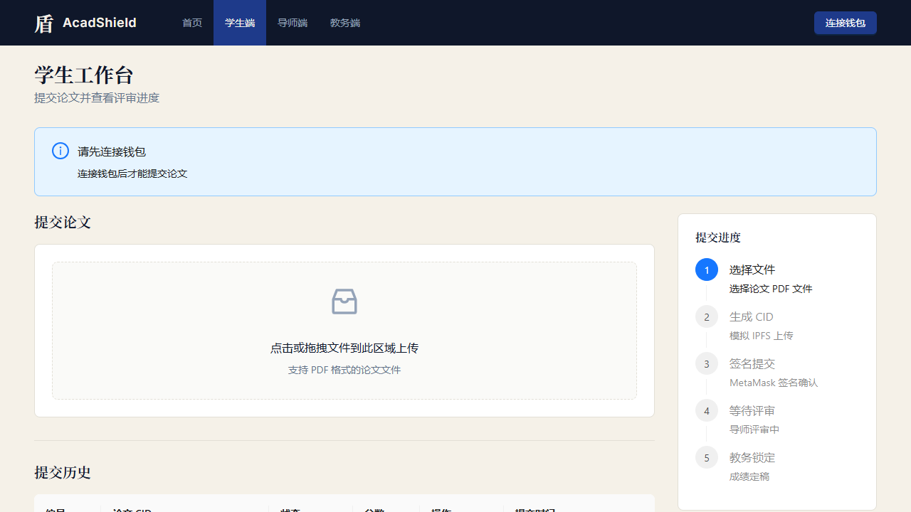
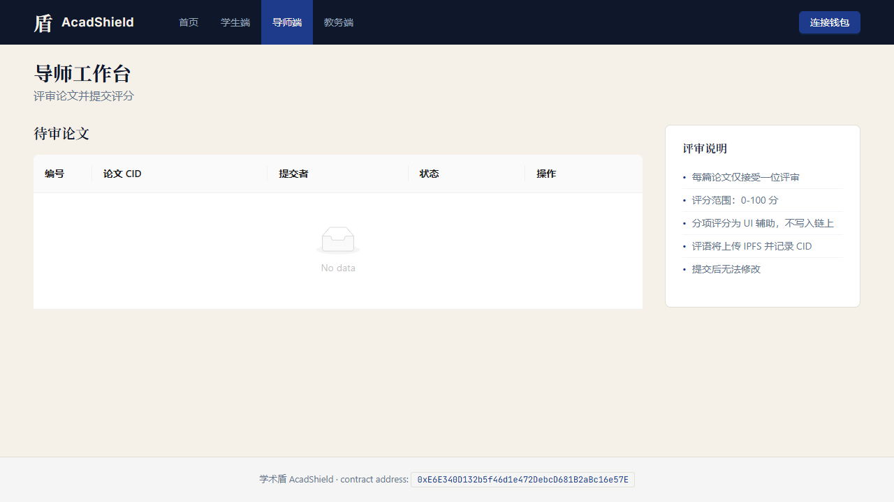
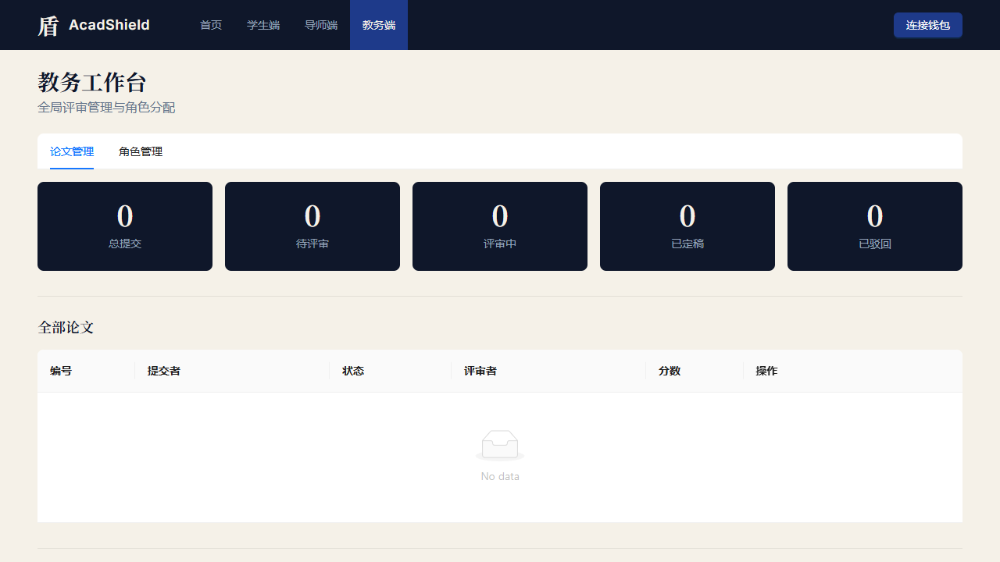

# AcadShield — 基于区块链的毕业论文评审系统

<p align="center">
  
</p>

<p align="center">
  <strong>透明 · 不可篡改 · 去中心化</strong>
</p>

---

## 简介

AcadShield 是一个基于以太坊智能合约的毕业论文评审管理平台，利用区块链技术解决传统论文评审中的信任与透明度问题。系统实现了论文提交、评审、定稿、驳回的完整生命周期管理，所有操作记录上链，确保评审过程的公平性和数据不可篡改性。

## 核心特性

| 特性 | 说明 |
|------|------|
| **链上评审记录** | 所有论文状态变更均记录在以太坊区块链上，不可篡改 |
| **RBAC 权限控制** | 基于 OpenZeppelin AccessControl，区分学生、导师、教务三种角色 |
| **开放评审机制** | 任何已分配 REVIEWER_ROLE 的导师均可认领并评审待审论文 |
| **完整状态机** | `NOT_SUBMITTED → SUBMITTED → UNDER_REVIEW → FINALIZED / REJECTED` |
| **多次提交** | 学生可提交多篇论文，每篇独立管理 |
| **IPFS 文件存储** | 论文文件通过 CID 关联，支持链下存储 |

## 系统架构

```
┌─────────────┐     ┌──────────────────┐     ┌─────────────────┐
│   Vue 3 前端  │────▶│  ethers.js v6    │────▶│  AcadShield.sol │
│  (Vite + AntD)│     │  (Web3 Provider) │     │  (Hardhat 本地链) │
└─────────────┘     └──────────────────┘     └─────────────────┘
```

## 快速开始

### 环境要求

- Node.js >= 18
- npm 或 yarn

### 1. 启动本地区块链

```bash
cd acadshield-thesis-review-contract
npx hardhat node
```

### 2. 部署合约

```bash
npx hardhat run scripts/deploy.js --network localhost
```

### 3. 启动前端

```bash
cd acadshield-thesis-review-frontend
npm install
npm run dev
```

### 4. 连接钱包

使用 Hardhat 提供的测试账户（在终端输出中查看私钥），通过 MetaMask 连接本地网络（RPC: `http://127.0.0.1:8545`，Chain ID: `31337`）。

## 页面预览

<p align="center">
  
</p>

<p align="center">
  
</p>

<p align="center">
  
</p>

<p align="center">
  
</p>

## 项目结构

```
acadshield-thesis-review/
├── acadshield-thesis-review-contract/   # 智能合约 (Hardhat)
│   ├── contracts/AcadShield.sol         # 核心合约
│   ├── scripts/deploy.js               # 部署脚本
│   └── test/AcadShield.test.js         # 单元测试 (19 个)
├── acadshield-thesis-review-frontend/   # 前端 (Vue 3 + Vite)
│   ├── src/
│   │   ├── views/                      # 页面组件
│   │   ├── components/                 # 公共组件
│   │   └── composables/                # 组合式函数
│   └── ...
└── docs/                               # 宣传素材
```

## 技术栈

- **智能合约**: Solidity 0.8.28 + OpenZeppelin + Hardhat
- **前端框架**: Vue 3 (Composition API) + Vite
- **UI 组件库**: Ant Design Vue
- **区块链交互**: ethers.js v6
- **动画**: GSAP
- **测试**: Hardhat + Chai

## 许可证

MIT License
